# Compiler architecture

The Rust compiler loads and checks Qleisli source, then lowers supported
programs into IR and evidence proposals. Source checks explain errors in
source terms. The independent native verifier decides acceptance of the
resulting artifacts.

[Mermaid source](diagrams/compiler.mmd)

## Source checking

Project loading fixes the source modules, imports, and edition. The parser
builds syntax trees with source locations. The common source checker resolves
names and checks types, effects, ownership, and the requirements of operation
calls. It checks both arms of a branch and the body of a zero-iteration fold.
The [source text](../reference/source-text.md) and
[type model](../reference/type-model.md) describe those checks.

Consider the [attempt to measure the same qubit twice](../learn/ownership.md).
The parser can read both calls. The source checker records that the first
call consumed `q`, so it can point to the second use and explain the error
before lowering the function.

## Specialization and lowering

**Specialization** resolves static arguments to concrete types, sizes, and
operation providers. **Elaboration** expands supported surface forms into
operations in a selected intermediate representation. For example, the
source checker checks both arms of `if static`, then elaboration selects the
arm determined by the concrete condition.

| Route | Proposal |
| --- | --- |
| Finite project | Finite Raw operations and a serialized QIRF artifact. |
| Selected Raw | A Raw operation program for the selected source entry. |
| Selected hierarchy | A composition of operations and proposals for the finite leaves on which it depends. |

The [elaboration contracts](../reference/elaboration.md) specify which forms
each route supports. Concrete artifacts and any applicable requests go to
the [native verifier](verifier.md). The host can map failures back to
source locations when it has the corresponding source information.

## Status and limits

A generic declaration may pass source checks before a concrete instantiation
has a native decision. Support for a source form depends on the chosen
lowering route. An IR check establishes the properties of the submitted
artifact in its checked scope. A source-preservation claim also needs
evidence connecting the original source and dependencies to that artifact.
See the [production boundary](../reference/production-boundary.md).
