# Rust core crate map

The root Cargo manifest defines one production package, `qleisli`, with
a library and a CLI target. Its compiler, native-checker client, simulator,
and interchange code are modules of that library. The diagram proposes a
future Cargo workspace for those responsibilities. Package names and splits
are design candidates.

A solid arrow goes from a Cargo package to a package it depends on. The
dashed arrow is a native process call to the Lean verifier.
[Mermaid source](diagrams/rust-crates.mmd)

## Proposed crate responsibilities

| Package | Responsibility |
| --- | --- |
| `qleisli` | Public library API and CLI composition. Selects the source, check, execution, or export route. |
| `qleisli-compiler` | Loads and checks source, specializes it, and produces Core IR, Circuit IR, and lowering evidence. |
| `qleisli-core-ir` | The canonical typed, first-order program representation, including ownership, effects, and exact contracts. |
| `qleisli-circuit-ir` | A structured circuit representation with ordered wires, reusable composition, and explicit measurements. |
| `qleisli-ir-types` | Shared representation types such as ordered ports and exact coefficients for the two IRs. |
| `qleisli-kernel-client` | Encodes native requests, validates replies, and constructs private execution handles from matching Lean decisions. |
| `qleisli-runtime` | Simulates and samples supported programs using accepted execution handles. |
| `qleisli-interop` | Adapts supported external inputs into proposals and exports supported target formats under their applicable checks. |

## Boundaries

The compiler and IR crates produce or represent proposals. Core IR carries
the canonical program meaning. Circuit IR represents a lower-level
structure whose correspondence to Core needs checked evidence. Source-to-Core
correspondence and target realization have their own evidence obligations.

The [native verifier](verifier.md) is built from a separate Lean package.
It decides whether each submitted artifact and its evidence satisfy the
requested checks. The Rust client binds the decision to the exact retained
data before the runtime or exporter uses it. Qleisli source projects select
their own [qrate and edition](../reference/packages-and-artifacts.md) through
`Qargo.toml`. Cargo packages organize the Rust implementation.

## Status and limits

The map is a packaging proposal informed by the planned Core and Circuit IR
boundary. Workspace membership, public package names, and re-exports need
review alongside compatibility and the compiler design.

## History

The [Core and Circuit IR design](https://github.com/MGYamada/Qleisli/issues/382)
records the intended IR and preservation boundaries. The
[v1 compiler design](https://github.com/MGYamada/Qleisli/issues/286) describes
the requirements for the eventual implementation boundary.
