# System architecture

Qleisli uses a Rust host and a separate native Lean verifier. The host reads
source programs or external artifacts and prepares an **intermediate
representation** (IR) for checking. The verifier decides whether the
submitted artifact meets the checks for the requested mode. An execution
decision authorizes the host to use the checked representation for a supported
run, sample, or export.

[Mermaid source](diagrams/system.mmd)

## Components

| Component | Responsibility |
| --- | --- |
| Source project | Groups `.qli` modules and selects the language edition in `Qargo.toml`. The bundled standard library supplies reusable operations. |
| Rust host | Provides the `qleisli` CLI and Rust library. The Python client calls the CLI. The [compiler](compiler.md) lowers source, and input adapters prepare proposals for supported external formats. |
| Native verifier | Independently checks proposals in a separate process. The [verifier chapter](verifier.md) explains what an execution decision binds. |
| Simulation and export | The Rust host uses the accepted representation to simulate or sample supported programs. Export additionally requires the checks for the selected format and target profile. |

## A program through the system

For a Bell-pair program, `qleisli check` reads the project and checks its
concrete functions through the native verifier. `qleisli run` obtains an
execution decision for the selected entry and simulates it. The result is a
distribution over the measured bits. `qleisli sample` reports sampled
outcomes from the simulated model. Try the [Bell-pair lesson](../learn/bell-pair.md)
to see the distribution change when you replace the controlled gate with
two independent preparations.

## Status and limits

The simulator implements a reference model. External formats such as
OpenQASM 3 and QIR have bounded experimental profiles. Native acceptance
covers the submitted artifact and its requested checks. Correspondence to
the original source, the execution result, or emitted hardware operations
requires its own evidence. See the
[production boundary](../reference/production-boundary.md) and
[target realization](../reference/realization.md).
