# Verifier architecture

The native verifier is the `qleisli-kernel` executable built from the
Mathlib-free Lean package in `lean-kernel/`. The Rust host submits a proposal
to this process. The verifier decodes the input independently and checks the
artifact, request, and evidence required by the selected mode.

[Mermaid source](diagrams/verifier.mmd)

## Request and independent checks

The host sends a versioned **QLV3 envelope** containing the edition, requested
scope, original payload, and any required views. The invocation selects a
mode and product version. The verifier checks this context and applies the
mode's checks to the decoded data. For example, an ordinary QIRF check covers
ownership and classical scope, and a finite contract mode checks the
requested equation against the decoded artifact.

## Execution binding

An **execution view** describes the data the Rust host retains for execution.
The host encodes the view in the canonical **QDV1** format. The verifier
derives its own view from the data it decodes and checks, then compares the
encoded bytes. The requested scope determines which views it compares.
An inspection result covers inspection. The host constructs its private
accepted execution handle only from a matching execution decision.

A malformed input, failed check, or view mismatch rejects the request.
The host also rejects when the selected verifier is missing or incompatible.
The [execution-view reference](../reference/execution-view.md) specifies the
envelope, scope, comparison, and reply formats.

You can see the scope of a decision in the [Bell-pair project](../learn/bell-pair.md).
Run `qleisli check bell-lab` and look for `entry request checked: false`.
This command checks the project's concrete functions. When you run
`qleisli run bell-lab`, the CLI requests an execution decision for `main`
before simulating the two measurements.

## Status and limits

The separate `lean/` package contains mathematical models and proofs about
the executable checks. The two admitted guarantees concern ownership and
classical scope of the decoded ordinary root. Source and runtime
correspondence, target realization, and full quantitative resource bounds
have separate proof obligations. See the
[production boundary](../reference/production-boundary.md) for the scope of
each check.
